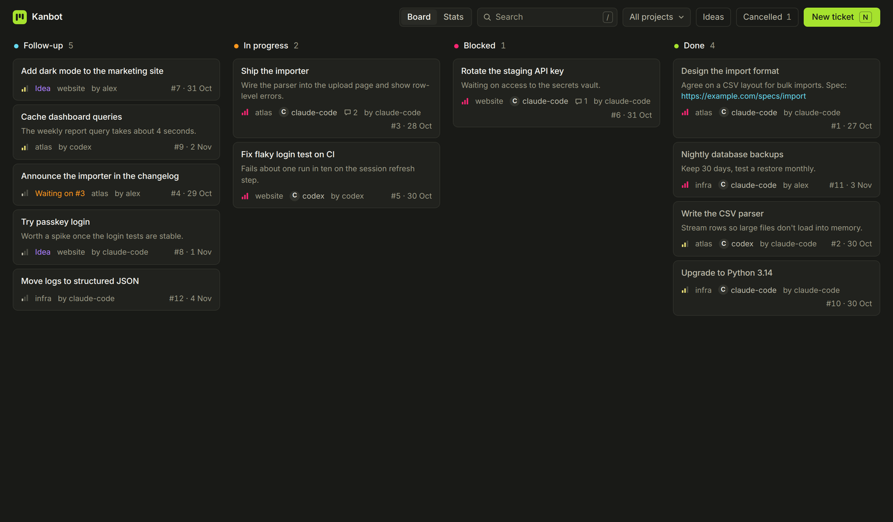
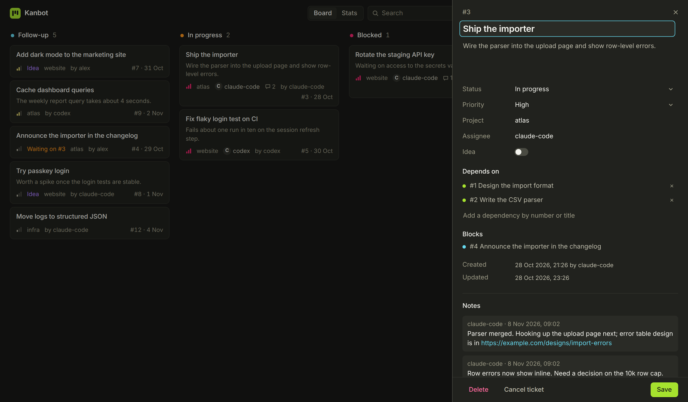
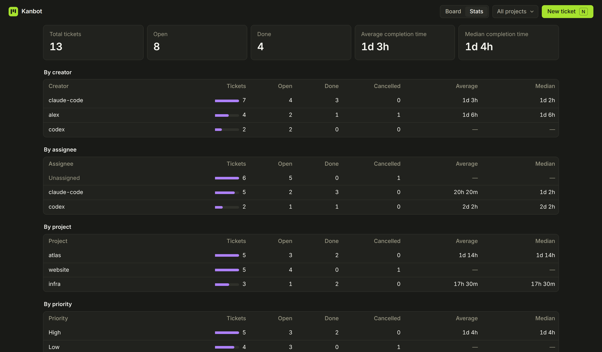
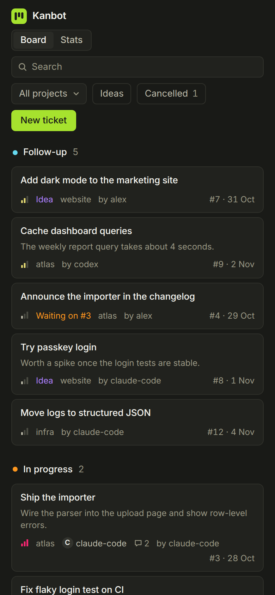

<p align="center"></p>

<h1 align="center">Kanbot</h1>

<p align="center">A local kanban board for you and your AI coding agents.</p>

> [!CAUTION]
> **This is a completely vibecoded app.** It was written by AI agents, mostly Claude, from conversational requests, with little line-by-line human review. It has tests and has been used daily, but treat it as experimental:
>
> - **No login:** anyone who can reach the port can read, change or delete every ticket. Keep it on `localhost` or a trusted home network.
> - **Not reviewed for security:** no audit or hardening for exposure on the internet has been done.
> - **Keep backups:** your data lives in a single SQLite file, and it's backed up automatically on start, but take your own copies too.
> - **No stability promises:** the API and data format may change without notice.
>
> Use it at your own risk.



## What it does

Agents create and update tickets through a JSON API while they work, and you watch, edit and steer from a web UI.

- **Columns:** Follow-up, In progress, Blocked and Done, plus a hidden Cancelled column.
- **Tickets:** priorities, project tags, ideas, assignees and creators.
- **Agent coordination:** dependencies, a `ready` filter for work with nothing left to wait on, and claims that stop two agents taking the same ticket.
- **History:** notes for handoffs, and a change history recording who changed what.
- **Stats:** ticket counts and completion times by creator, assignee, project and priority.
- **Live updates:** agent changes appear within 3 seconds, without reloading.
- **Search and shortcuts:** search, project filters, and `N` and `/` keyboard shortcuts.
- **No runtime dependencies:** a single Python process with no third-party packages and a SQLite file. It runs locally, as a systemd service, or in Docker on a NAS.

| Ticket panel | Stats | Phone |
|---|---|---|
|  |  |  |

## Quick start

You need [uv](https://docs.astral.sh/uv/). It fetches the right Python for you.

```sh
git clone git@github.com:alexanderchiu/kanbot.git
cd kanbot
uv run kanbot                     # http://127.0.0.1:8787
```

Options: `--port`, `--db` (the default is `kanban.db` in the folder you start it from), `--backup-dir`, `--host` and `--allowed-hosts`. Each has a `KANBOT_*` environment variable equivalent; see `--help`.

## Ways to run it

- **On your machine, always on:** `./install.sh` installs a systemd user service that starts at login and restarts on failure. Run it again after updating the code: the service doesn't restart itself, and the page is served fresh, so it can get ahead of an old server. Check it with `systemctl --user status kanbot` and `journalctl --user -u kanbot -f`. It stops when you log out, unless you run `loginctl enable-linger`. To remove it, run `systemctl --user disable --now kanbot`, then delete `~/.config/systemd/user/kanbot.service`.
- **On a Synology NAS or any Docker host:** see [docs/synology.md](docs/synology.md). For any Docker host, copy `.env.example` to `.env`, edit it, and run `docker compose up -d --build`.

## Using the board

- **Creating tickets:** press `N` or use **New ticket**, or the **+** on a column.
- **Moving tickets:** drag cards between columns and to reorder them.
- **Editing:** click a card to open its panel. There you can edit fields, add notes, manage dependencies, see history, and cancel or delete the ticket.
- **Finding tickets:** press `/` to search by number, text, project, assignee or creator. The **Project** menu and the **Ideas** and **Cancelled** toggles filter the board.
- **Stats:** **Stats** shows counts and completion times, filtered by the same project menu.
- **Cards:** each card shows its priority, project, assignee, creator, note count, what it's waiting on, and when it was created, or completed once it's done. Links in descriptions and notes are clickable.

## Backups

Each time the server starts, it copies the database to `backups/` beside it, unless nothing has changed since the last copy, and always before upgrading the database. It keeps the newest 30. To restore one, stop the server and copy a backup over `kanban.db`.

## API

See [docs/api.md](docs/api.md) for the full reference. `GET /api` describes the API in JSON.

## Instructions for agents

Paste this into your `CLAUDE.md` or your agent's instructions:

````markdown
## Task board

Track work on Kanbot, the local kanban board, at http://127.0.0.1:8787. Set `project` to the
current project's name. Run `curl -s http://127.0.0.1:8787/api/projects` to reuse an
existing tag.

- Before creating a ticket, check for a duplicate:
  `curl -s 'http://127.0.0.1:8787/api/tickets?q=login'`
- Starting work (priority is `high`, `medium` or `low`):
  `curl -s http://127.0.0.1:8787/api/tickets -d '{"title": "Fix login bug", "status": "in_progress", "priority": "high", "project": "website", "created_by": "claude-code", "assignee": "claude-code"}'`
- Taking an existing ticket, which fails with a 409 if someone else holds it:
  `curl -s http://127.0.0.1:8787/api/tickets/42/claim -d '{"assignee": "claude-code"}'`
- Recording work for later:
  `curl -s http://127.0.0.1:8787/api/tickets -d '{"title": "Add login tests", "description": "Cover the expired-session case.", "project": "website", "created_by": "claude-code"}'`
- Recording an idea, as opposed to committed work:
  `curl -s http://127.0.0.1:8787/api/tickets -d '{"title": "Try passkey login", "idea": true, "priority": "low", "project": "website", "created_by": "claude-code"}'`
- Finishing work:
  `curl -s -X PATCH http://127.0.0.1:8787/api/tickets/42 -d '{"status": "done", "actor": "claude-code"}'`

- Recording progress, a handoff, or why work is blocked or cancelled:
  `curl -s http://127.0.0.1:8787/api/tickets/42/notes -d '{"body": "Waiting on the API key.", "author": "claude-code"}'`
- Marking work as stuck:
  `curl -s -X PATCH http://127.0.0.1:8787/api/tickets/42 -d '{"status": "blocked", "actor": "claude-code"}'`
- Dropping work that's no longer needed, which keeps the ticket on record:
  `curl -s -X PATCH http://127.0.0.1:8787/api/tickets/42 -d '{"status": "cancelled", "actor": "claude-code"}'`

To find work to pick up, query `ready=true`. Add `"depends_on": [42]` when one ticket must wait for another. `GET /api` describes the full API.
````

## Development

```sh
uv run pytest                     # tests
uv run ruff check                 # lint
uv run ruff format                # format
```

The backend is the `kanbot` package in `src/kanbot/`, with tests in `tests/`. The UI is in `src/kanbot/static/`. Notes for agents working on this repo are in [CLAUDE.md](CLAUDE.md). README screenshots use made-up demo data.

## License

[MIT](LICENSE)
